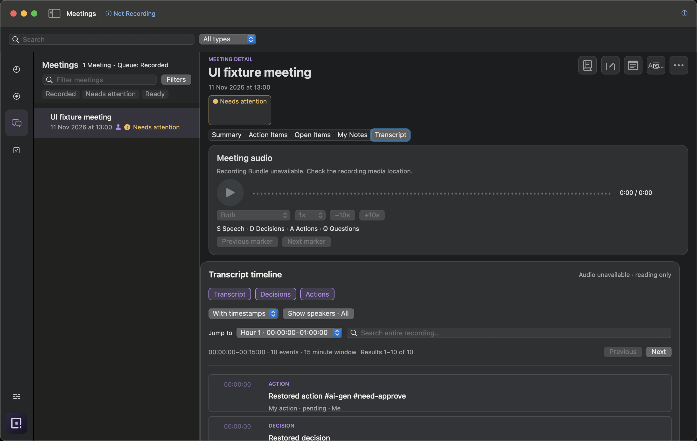

# Ticket 21 follow-up — Restore the mixed timeline panel

User request: restore the rounded mixed timeline UI shown from commit `4e341c565409538973e3778dab2ddad32d0b0a44`, combined with the newer reader functionality. This follow-up is reviewed and coverage-gated against `47472ba43697bdb4b338728dacf17a8088b9783b`, which includes completed ticket 22 work. No ticket 22 player implementation was replaced.

## Resulting behavior

- Restored the **Transcript timeline** panel, rounded Graphite Focus surface, padded violet Transcript / Decisions / Actions multi-select filters, bordered event cards, left timecode column, type captions, and speaker/context below the event text. The user's reference layout supersedes the previous inline name/time placement for this follow-up.
- Cited Decisions and Action Items appear alongside speech at their saved source times. Their mapped playback positions and source-segment identities are retained separately. Missing or invalid source links display unavailable context and cannot seek. No time or speaker is fabricated for an outcome.
- Normal browsing uses 15-minute windows, with an hour picker and Previous/Next controls. Rendering remains bounded to 100 events per page within a window.
- Find searches the entire recording, including event text and speaker/action context. Highlights and next/previous traversal cover both fields and all result pages. In Clear text, context is shown when needed to expose a matching snippet.
- With timestamps, Clear text, By speakers, multi-speaker selection, the saved view preference, keyboard commands, read-only text, copy context menus, stable reading state, and playback highlighting remain available. Inactive match-traversal controls stay hidden until searching.
- The existing ticket 22 player remains: synchronized tracks, waveform, speed, seeking, markers, gap handling, and pending source seeks. Timeline cards use the original source's mapped position rather than their presentation-row IDs.

## Verification

The previously agreed public reader-state and native UI seams were used. Red/green tests covered mixed types, window/hour navigation, whole-recording search, source projection, unavailable sources, and context search. Hosted tests check actual controls, styling, highlighted context in Clear text, paging, and source navigation.

Final package lane: **465 tests, four existing opt-in skips, zero failures**. Final hosted lane: **52 tests, zero skipped or failed**. Evidence: `/private/tmp/stillmatter-timeline-package-final/` and `/private/tmp/stillmatter-timeline-hosted-final/`.

The final native run uses six targeted scenarios: restored mixed panel; long-recording search/pagination; views/speakers/keyboard/persistence/contextual copy; empty Transcript; five-tab workspace; and playable-audio behavior. Native test identifiers use AppKit's actual checkbox roles for multi-select type filters. Screenshots are retained through sandbox-safe XCTest attachments, rather than writing outside the runner sandbox.

The final native lane passed **all six scenarios, zero skipped or failed**, on the final production source. Evidence: `/private/tmp/stillmatter-timeline-native-verified/` (including `results.xcresult`, execution status, logs and normalized coverage). Synthetic workspaces, support/media directories and preference namespaces isolate every test from the real library. Assertions verify that reading/filtering/searching do not rewrite saved Transcript data. These UI tests do not establish speech-model quality or capture-isolation capability.

Independent Standards and Spec reviewers found **zero remaining findings** through `f4b2b22` (production source `b65e72c`). An initial low-priority duplicated-reset heuristic was addressed with a shared reset method. The old reference's context-search behavior was also restored. The debug-only fixture's expected first window now contains 15 minute-spaced phrases; its existing release exclusion scope is unchanged, and its reviewed content hash was updated.

Exploratory runs that overlapped implementation were not used as final coverage evidence. The initial panel UI test exposed test-harness issues (a disallowed direct screenshot write and button queries for checkbox-role controls); these were corrected. The empty-state assertion now reflects intentionally hidden inactive match controls. Only compatible final-source reports are used for the gate.


## Coverage and preview

The combined gate exited **0** against `47472ba43697bdb4b338728dacf17a8088b9783b`: **228/229 changed executable lines (99.5633187773%)**, passing the unchanged 95% requirement. Presentation is **92/92 (100%)**; app/UI is **136/137 (99.27%)**. All shipped source files have executable maps. Report: `/private/tmp/stillmatter-timeline-incremental-gate.json`.

These compatible lanes measure existing whole-source coverage at **19,229/23,521 (81.75%)**: Core 94.00%, Presentation 86.71%, runtime 94.24%, app/UI 69.99%. This uses a focused native UI lane and is not a whole-app acceptance claim. Final whole-source coverage and real speaker/model-quality evaluations remain ticket 50 work; their requirements were not weakened.

Reproduce the slice gate:

```sh
python3 scripts/coverage.py report \
  --reports /private/tmp/stillmatter-timeline-package-final/report.json \
            /private/tmp/stillmatter-timeline-hosted-final/report.json \
            /private/tmp/stillmatter-timeline-native-verified/report.json \
  --base 47472ba43697bdb4b338728dacf17a8088b9783b \
  --output /private/tmp/stillmatter-timeline-incremental-gate.json
```

The preview below is an unchanged window-only screenshot from the passing native mixed-panel test. Its synthetic fixture has no retained audio, so the player and timecodes truthfully show unavailable/disabled states; playable-media behavior passes in the separate generated-audio scenario.


